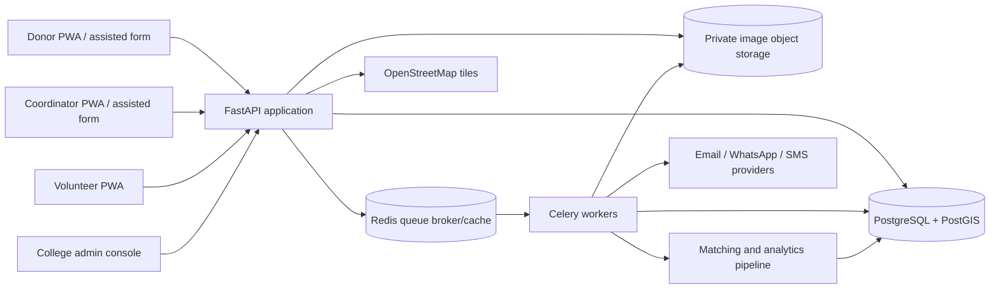
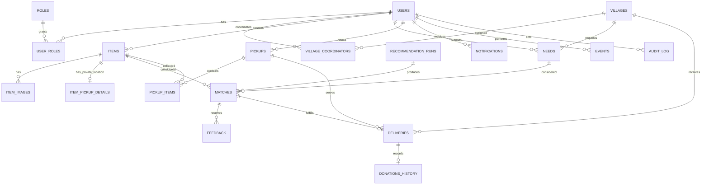

# CMP Architecture (Phase 1)

## System architecture



PostgreSQL is the source of truth for users, listings, needs, recommendation runs, workflow state, feedback, and events. Image binaries are stored outside the database behind private keys and short-lived access URLs. Redis/Celery handles work that should not block low-bandwidth requests, such as image processing, candidate scoring, notifications, and scheduled analytics. The future React PWA is the shared interface for donor, coordinator, volunteer, and admin roles; coordinator-assisted and low-connectivity workflows should remain usable without image or map downloads.

## Main data flow

1. Donor creates an item and uploads up to four validated images. A private object key is saved; model suggestions remain editable and untrusted until moderation.
2. A verified coordinator creates a need, optionally from Hindi/English text or voice transcription, and confirms extracted fields before it becomes matchable.
3. A recommendation run generates item-need candidates, stores model/version metadata and feature snapshots, then creates ranked match suggestions.
4. A coordinator accepts or rejects a suggestion. Rejections require a reason. Accepted matches progress through pickup, transit, delivery, and recipient confirmation.
5. Each meaningful action emits an event. Confirmed deliveries create donation-history rows used for impact reporting. Synthetic and real origins are retained for analysis and training.

## Entity relationship diagram



## Proposed repository layout

```text
.
|-- backend/
|   |-- app/                  # FastAPI routers, services, auth, schemas
|   |-- tests/                # pytest unit and API tests
|   `-- pyproject.toml
|-- frontend/                 # React + Tailwind mobile-first PWA
|-- db/
|   |-- migrations/           # versioned SQL migrations
|   `-- seeds/                # reference data only; synthetic data is separate
|-- data/
|   |-- synthetic/            # generated, clearly labeled datasets
|   `-- reports/              # reproducible exports and evaluation reports
|-- notebooks/                # 01-06 lifecycle notebooks
|-- ml/
|   |-- data/                 # generation, validation, feature building
|   |-- training/             # baseline, regression, ranking, forecasting
|   `-- evaluation/           # time/group-aware metrics and reports
|-- docs/                     # architecture, dictionary, pilot, final report
|-- docker-compose.yml
`-- README.md
```

Only `docs/`, `db/migrations/`, and the root README are created in Phase 1. Other folders should be added when their phases begin, avoiding empty scaffolding that implies unfinished services already exist.

## Security and operations boundaries

- Authenticate college donors through a college identity provider; do not store passwords in this schema. Recipient/coordinator accounts require admin verification and village assignment.
- Enforce role and village-scoped access in API authorization. Never expose donor email, phone, or pickup details in public or recipient-facing payloads. Pickup details are accessible only to the donor, authorized admin, and volunteer assigned to that pickup.
- Validate image MIME type, dimensions, and size; store files privately; issue expiring URLs. Enforce the four-image cap in the upload service within a transaction.
- Treat LLM and vision output as suggestions. Human confirmation and moderation control publication and matching eligibility.
- Use append-only permissions for `events` and `audit_log`; do not include unnecessary sensitive values in event payloads.
- Keep synthetic/real source labels in every analytical extract and report. Never describe synthetic results as pilot impact.

## Phase 1 assumptions and limits

- One college operates the deployment; multiple recipient villages and organizations are supported.
- Village coordinates are stored as PostGIS geography points. Exact donor pickup addresses are stored separately from public item data and are accessible only for an authorized pickup workflow.
- One match row means one item-need pair in one recommendation run. Bulk matching and kit composition are future features.
- State transition authorization and ordering belong in the backend service layer, with database constraints preventing invalid values but not all invalid transitions.
- The schema is a foundation, not a production security certification. Retention policy, consent text, legal review, provider selection, and deployment secrets must be settled before a real pilot.
